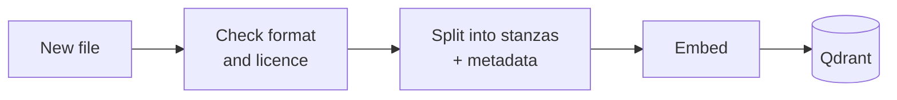
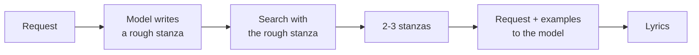
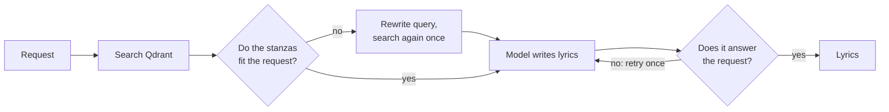

# LMusic Architecture Design & Project Plan

*Milestone 2*

## 1. Problem and data

### 1.1 Problem

General-purpose LLMs write fluent text but are unreliable at **Romanian rhyme and metre**. They generate token by token without "hearing" the words, so they miscount syllables and pair endings that do not rhyme. Most of their training data is English, which makes the problem worse for Romanian.

LMusic helps **songwriters who are stuck on a line or a chorus**, and **anyone curious** who wants better rhymes for a song, a poem or a toast. The user describes what they need, for example *"4 lines about a summer break-up, rhyme ABAB, 8 syllables per line, pop"*, and gets original lyrics that respect that form.

**Tasks**
1. **Constrained lyric generation** (main task): theme + form (lines, syllables, rhyme scheme) → original lyrics.
2. **Form analysis**: any text → its rhyme scheme and syllables per line.
3. **Trend guidance**: "what do current hits look like?" → genres, tempo and song structures from radio charts, used as style input for task 1.

### 1.2 Data

| Source | What we store | Why |
|---|---|---|
| Romanian **public-domain poems and songs** (e.g. Wikisource; folk songs; old songs) | Full text, split into stanzas | Correct Romanian rhyme and metre that we may legally store and show |
| **Lyrics written by the team**  | Full text | Modern song language; classic poems alone would make the output sound like the 19th century |
| **Synthetic lyrics**, kept only if they pass our syllable and rhyme checks | Full text | Scales the amount of modern-style examples |
| **Radio charts** (weekly Romanian airplay tops) | **Metadata only**: title, artist, rank, week, genre, tempo, structure | Shows which genres and styles are popular now, without copying protected lyrics |

**Copyright rule.** In Romania a work becomes free to use 70 years after its author's death, counted from 1 January of the following year (Law 8/1996). In 2026 that means authors who died in 1955 or earlier. For songs, what counts is the lyricist, not the performer. Current hits are protected, so we keep only their metadata.

### 1.3 Ingesting new data

New data is added with one command (or an upload in the UI). It is checked, split into stanzas, embedded and written to the database, and becomes searchable immediately, with no other change to the system.

*How to read it:* a file is accepted only if its format is valid and its licence is allowed. Each stanza is then stored with its metadata.

Every stanza carries metadata that we can filter and audit on:

- `source`, `author`, `year` of the work, `license`
- `added_at`: when it entered the database, so the age of every record is visible
- `rhyme_scheme`, `n_lines`, `avg_syllables`: computed automatically by our tools
- `genre`, `emotion`, and `song_id` + `stanza_index`, to find the rest of the song

Re-importing the same file does not create duplicates: each stanza has a fixed id. Each week, the new radio top is added the same way.

---

## 2. RAG design

### 2.1 What retrieval is for: examples in the prompt (few-shot)

For lyric generation, retrieval is the default: the agent requests **2–3 real stanzas with a similar theme and the requested form**, then gives relevant results to the model **together with the request** as examples. A small model can use these examples as guidance for form and style. The prompt tells it never to copy them. Analysis of user-provided text can skip retrieval and call the verification tools directly. If retrieval finds no suitable examples, the agent proceeds without them and reports the limitation.

### 2.2 Chunking: one stanza per chunk, with metadata

- **Why stanzas.** Rhyme schemes and syllable patterns are defined per stanza, so every chunk has exactly one form and filters such as "ABAB, 4 lines, ~8 syllables" become exact. A stanza is also one idea (a verse or a chorus), and it is short (4–8 lines), which suits all embedding models.
- **Going back to the whole song.** Because each chunk stores `song_id` and `stanza_index`, a retrieved stanza can be "re-opened" into its full song when the context is needed.
- **What we will test.** Stanza chunks vs. whole-song chunks vs. single lines. We expect stanzas to work best, but we will decide by measurement.

### 2.3 Embedding models

We compare three open-source multilingual models of similar size (~0.6B parameters, 1024 dimensions). The scores are the MMTEB multilingual averages reported in the Qwen3-Embedding paper (same benchmark for all three):

| Model | MMTEB (multilingual) | Why consider it |
|---|---|---|
| Qwen3-Embedding-0.6B | **64.3** | Best score of the three |
| multilingual-e5-large-instruct | 63.2 | Strong, widely used baseline |
| BAAI/bge-m3 | 59.6 | Also produces word-level (sparse) vectors, useful for hybrid search |

A benchmark average does not show how a model handles Romanian lyrics, so we pick the model that retrieves best **on our own data** and on Romanian retrieval tasks (RoMTEB).

### 2.4 Vector database: Qdrant (vs. ChromaDB)

Both are open source and run **locally** from a folder on disk, with no server. We lean towards **Qdrant** because it supports **hybrid search**: one query combines meaning-based search (embeddings) with word-based search (BM25, with Romanian stemming). Lyrics need both: the right **theme** (meaning) and the right **sounds and words** (exact endings, refrains). We tested both: Qdrant ran hybrid search with metadata filters locally, while ChromaDB's local version does not support it (hybrid search is a Chroma Cloud feature).

### 2.5 RAG methods we will compare

**Method 1: standard RAG.** The request is used directly as the search query.

*Why:* the simplest and fastest option; the baseline the others must beat.

**Method 2: HyDE (search with a statement, not a question).** The model first writes a rough stanza on the theme; that draft, not the request, is used to search.

*Why:* a short request ("summer break-up") looks very different from a stanza, while a draft stanza looks like the stanzas we want to find (Gao et al., 2023). It costs one extra model call.

**Method 3: RAG with an LLM evaluator.** An LLM checks whether the retrieved stanzas really fit the request and whether the final answer does what was asked. Otherwise the system retries once or says it has nothing relevant (inspired by CRAG and Self-RAG).

*Why:* it stops irrelevant examples from steering the model and catches answers that miss the request, which reduces hallucination. It is the slowest method (up to two extra checks), so we measure whether the quality gain justifies the time.

**How we compare them.** On the Golden Dataset: whether the retrieved stanzas fit the request (context precision and recall), whether the lyrics respect the requested form, whether they copy any example, and response time.

---

## 3. Agent, Tools, and Model Choices

### 3.1 Model Choices (SLM)
For the core generative agent, we are targeting Small Language Models (SLMs) in the 3B-4B parameter range. This size is deliberately chosen to balance reasoning capabilities with hardware constraints, allowing us to perform QLoRA fine-tuning on consumer-grade GPUs (e.g., Google Colab, 16GB VRAM) and run fast, local inference for the iterative verify-refine loop.

Our primary candidates are:
*   **Phi-3-mini (3.8B):** Exceptional reasoning and instruction-following for its size; highly optimized for tool calling (crucial for our MCP setup).
*   **Llama-3.2-3B:** Meta’s latest lightweight model, offering robust context handling and strong base creativity.
*   **Qwen2.5-3B:** Included specifically for its superior native multilingual performance, which is a major advantage for processing Romanian lyrics and syntax.

**Rationale:** Rather than relying on massive, closed-source models via API (which introduce latency and cost), a locally fine-tuned SLM quantized to 4-bit (via `bitsandbytes`) guarantees data privacy, zero API costs, and the ability to strictly control the generation loop.

### 3.2 Agent and Tools (ReAct Loop via MCP)
The selected SLM will act as an orchestrator using a **ReAct (Reason + Act)** paradigm. It will identify the task and requested constraints, choose relevant tool calls, and revise a draft using their results. The application will enforce the required checks before returning a final answer, rather than relying solely on the model to request verification.

These tools will be exposed systematically via a **Model Context Protocol (MCP) Server**:
1.  **`syllable_counter(line)`:** A Python function using lexical syllabification data, where available and licensed, with a rule-based fallback. It returns the estimated syllable count and flags uncertain words; deterministic execution does not guarantee linguistic accuracy.
2.  **`rhyme_checker(word1, word2)`:** Assesses phonetic matching between line endings and returns a match result with uncertainty where needed. The application checks the relevant line pairs against the requested scheme (e.g., AABB or ABAB).
3.  **`sentiment_analyzer(text)`:** Estimates emotional tone and returns labels with associated scores. The agent compares these estimates with the requested mood; they are advisory signals, not proof of emotional correctness.
4.  **`retrieve_lyrics(query, mood, genre, rhyme_scheme, n_lines)`:** Searches the vector database using a thematic query and optional metadata filters. It returns relevant stanzas with source identifiers, metadata, and retrieval scores. This is the default context step for generation and can be skipped for analysis of supplied text.

**MCP connection.** The application will act as an MCP client connected to a local Python MCP server over `stdio`. The server will expose tools with typed input schemas and structured results. The client will discover the available tools, validate and execute calls selected by the agent, and pass their results back to the model as feedback. Invalid arguments, unavailable resources, and uncertain analyses will be reported explicitly. The model proposes calls; the application executes them.

**Decision flow and stopping conditions.** For generation, the agent retrieves context, writes a draft, and checks line count, syllable targets, rhyme pairs, and emotional fit where requested. For analysis, it applies the relevant checks directly to the supplied text. A mismatch (e.g., 9 syllables instead of 8) becomes feedback for revising the affected lines. The complete candidate is checked again after each revision because changing one line can affect rhyme or emotional fit. The application permits at most **3 refinement iterations**, including any regeneration prompted by the RAG evaluator in Section 2.5, and stops earlier when the requested checks pass. At the limit, it returns the best candidate with unresolved violations and uncertainty clearly identified. Tool failures are reported and never treated as successful verification.

---

## 4. Golden Dataset & Evaluation Strategy

To rigorously evaluate both our RAG retrieval performance and the SLM's formal constraint adherence, we are constructing a versioned **Golden Dataset (`data/golden_dataset.json`)** comprising **50 diverse, complex songwriting prompts**.

### 4.1 Dataset Composition & Creation
The dataset is manually curated by the team to represent real-world artistic constraints and edge cases. It contains no generated lyrics or reference answers to avoid copyright issues; any output that satisfies the requested form is considered valid. Each entry in the JSON structure contains:
*   **User Prompt:** A realistic, natural-language request where constraints appear dynamically (start, middle, or end of the sentence) and often use natural terminology (e.g., "rimă încrucișată" instead of "ABAB").
*   **Target Constraints:** Explicit metadata fields specifying the `theme` and `expected_constraints` (rhyme scheme, line count, and syllable targets). 
*   **Broad Coverage:** The dataset explicitly tests rhyme schemes (AABB, ABAB, ABBA, AABBCC, ABABAB, ABABCDCD), stanza lengths (4, 6, and 8 lines), syllable counts (7 to 11), and 46 distinct themes.
*   **Adversarial / Vague Inputs:** Seven requests (ids 43 to 49) deliberately omit one or more constraints to test how the agent gracefully handles incomplete or vague instructions.

### 4.2 Evaluation Metrics
We will evaluate our system against this dataset across three core dimensions:
1.  **Retrieval Evaluation (RAGAS / RAG Triad):** Measuring context precision and context recall to ensure Qdrant retrieves relevant stanzas that match the requested mood and form.
2.  **Constraint Adherence Score:** Using our automated MCP tools to independently verify whether the final generated lyrics strictly match the requested syllable count and rhyme scheme. Because syllable counts in Romanian are hard to check automatically with 100% accuracy, a representative sample will also be verified by hand.
3.  **Qualitative & Safety Metrics:** Human-in-the-loop evaluation for emotional resonance, singability, and naturalness, alongside automated checks for toxicity and hallucination mitigation.

---

## 5. Project Timeline (Weeks 6–14)
This timeline represents our commitment from the current architecture design phase to the final progress presentation, including all planned experiments.

*   **Week 6: Architecture & Evaluation Setup (Current)**
    *   Finalize and upload Architecture Document (Milestone 2).
    *   Complete `ingest_data.py` prototype and ChromaDB/Qdrant initialization.
    *   Publish `golden_dataset.json` (50 prompts).
*   **Week 7-8: Tooling & SLM Baseline**
    *   Develop and test the MCP Server with deterministic tools (syllables, rhymes).
    *   Set up the local/Colab training environment (Unsloth, HuggingFace).
    *   **Experiment 1 (Baseline):** Evaluate Zero-shot SLMs against the Golden Dataset to measure raw constraint adherence before any fine-tuning.
*   **Week 9-10: Agent Integration & Fine-Tuning**
    *   Execute QLoRA fine-tuning on the chosen SLM using lyrical datasets.
    *   Integrate the RAG pipeline with the ReAct agent loop.
    *   **Experiment 2 (RAG Strategies):** Compare Standard RAG, HyDE, and LLM Evaluator (as defined in Sec 2.5), alongside chunking sizes, using RAGAS context metrics.
*   **Week 11-12: Full System Evaluation & Pre-Christmas Milestone**
    *   Connect the fine-tuned Agent to the MCP server for the Generate-Verify-Refine loop.
    *   **Experiment 3 (Full System Ablation):** Measure final formal constraint adherence (rhyme/syllable accuracy post-refinement) vs. the baseline.
    *   *Deliverable:* Pre-Christmas GitHub Progress Review (Milestone 3).
*   **Week 13-14: Polish & Final Delivery**
    *   Implement toxicity guardrails, bug fixing, and edge-case handling.
    *   Prepare CLI/UI interface for demonstrations.
    *   *Deliverable:* Final Progress Presentation (Week 14).

---

### References

Law 8/1996 on copyright (Romania) · Gao et al., *HyDE*, ACL 2023 · Yan et al., *Corrective RAG*, 2024 · Asai et al., *Self-RAG*, ICLR 2024 · Zhang et al., *Qwen3 Embedding*, 2025 · Chen et al., *BGE M3-Embedding*, 2024 · Wang et al., *Multilingual E5*, 2024 · RoMTEB (github.com/alina0195/roMTEB)
