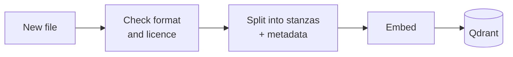
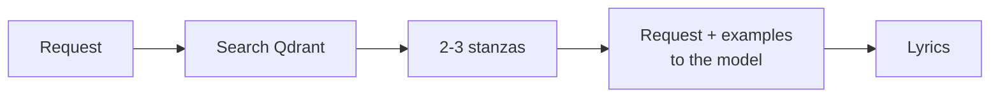
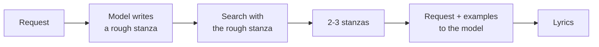
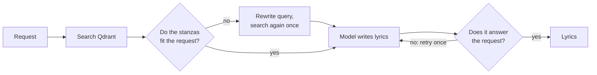

# Problem, Data and RAG Design

*LMusic · Milestone 2*

## 1. Problem and data

### 1.1 Problem

General-purpose LLMs write fluent text but are unreliable at **Romanian rhyme and metre**. They generate token by token without "hearing" the words, so they miscount syllables and pair endings that do not rhyme. Most of their training data is English, which makes the problem worse for Romanian.

LMusic helps **songwriters who are stuck on a line or a chorus**, and **anyone curious** who wants better rhymes for a song, a poem or a toast. The user describes what they need, for example *"4 lines about a summer break-up, rhyme ABAB, 8 syllables per line, pop"*, and gets original lyrics that respect that form.

**Tasks**
1. **Constrained lyric generation** (main task): theme + form (lines, syllables, rhyme scheme) → original lyrics.
2. **Form analysis**: any text → its rhyme scheme and syllables per line.
3. **Trend guidance**: "what do current hits look like?" → genres, tempo and song structures from radio charts, used as style input for task 1.

### 1.2 Data

| Source | What we store | Why |
|---|---|---|
| Romanian **public-domain poems and songs** (e.g. Wikisource; folk songs; old songs) | Full text, split into stanzas | Correct Romanian rhyme and metre that we may legally store and show |
| **Lyrics written by the team**  | Full text | Modern song language; classic poems alone would make the output sound like the 19th century |
| **Synthetic lyrics**, kept only if they pass our syllable and rhyme checks | Full text | Scales the amount of modern-style examples |
| **Radio charts** (weekly Romanian airplay tops) | **Metadata only**: title, artist, rank, week, genre, tempo, structure | Shows which genres and styles are popular now, without copying protected lyrics |

**Copyright rule.** In Romania a work becomes free to use 70 years after its author's death, counted from 1 January of the following year (Law 8/1996). In 2026 that means authors who died in 1955 or earlier. For songs, what counts is the lyricist, not the performer. Current hits are protected, so we keep only their metadata.

### 1.3 Ingesting new data

New data is added with one command (or an upload in the UI). It is checked, split into stanzas, embedded and written to the database, and becomes searchable immediately, with no other change to the system.

*How to read it:* a file is accepted only if its format is valid and its licence is allowed. Each stanza is then stored with its metadata.

Every stanza carries metadata that we can filter and audit on:

- `source`, `author`, `year` of the work, `license`
- `added_at`: when it entered the database, so the age of every record is visible
- `rhyme_scheme`, `n_lines`, `avg_syllables`: computed automatically by our tools
- `genre`, `emotion`, and `song_id` + `stanza_index`, to find the rest of the song

Re-importing the same file does not create duplicates: each stanza has a fixed id. Each week, the new radio top is added the same way.

---

## 2. RAG design

### 2.1 What retrieval is for: examples in the prompt (few-shot)

When a user asks for lyrics, the system first finds **2–3 real stanzas with a similar theme and the same form**, then gives them to the model **together with the request** as examples. A small model imitates a form it can see much better than a form described in words. The prompt tells it to use the examples for style and structure, never to copy them.

### 2.2 Chunking: one stanza per chunk, with metadata

- **Why stanzas.** Rhyme schemes and syllable patterns are defined per stanza, so every chunk has exactly one form and filters such as "ABAB, 4 lines, ~8 syllables" become exact. A stanza is also one idea (a verse or a chorus), and it is short (4–8 lines), which suits all embedding models.
- **Going back to the whole song.** Because each chunk stores `song_id` and `stanza_index`, a retrieved stanza can be "re-opened" into its full song when the context is needed.
- **What we will test.** Stanza chunks vs. whole-song chunks vs. single lines. We expect stanzas to work best, but we will decide by measurement.

### 2.3 Embedding models

We compare three open-source multilingual models of similar size (~0.6B parameters, 1024 dimensions). The scores are the MMTEB multilingual averages reported in the Qwen3-Embedding paper (same benchmark for all three):

| Model | MMTEB (multilingual) | Why consider it |
|---|---|---|
| Qwen3-Embedding-0.6B | **64.3** | Best score of the three |
| multilingual-e5-large-instruct | 63.2 | Strong, widely used baseline |
| BAAI/bge-m3 | 59.6 | Also produces word-level (sparse) vectors, useful for hybrid search |

A benchmark average does not show how a model handles Romanian lyrics, so we pick the model that retrieves best **on our own data** and on Romanian retrieval tasks (RoMTEB).

### 2.4 Vector database: Qdrant (vs. ChromaDB)

Both are open source and run **locally** from a folder on disk, with no server. We lean towards **Qdrant** because it supports **hybrid search**: one query combines meaning-based search (embeddings) with word-based search (BM25, with Romanian stemming). Lyrics need both: the right **theme** (meaning) and the right **sounds and words** (exact endings, refrains). We tested both: Qdrant ran hybrid search with metadata filters locally, while ChromaDB's local version does not support it (hybrid search is a Chroma Cloud feature).

### 2.5 RAG methods we will compare

**Method 1: standard RAG.** The request is used directly as the search query.

*Why:* the simplest and fastest option; the baseline the others must beat.

**Method 2: HyDE (search with a statement, not a question).** The model first writes a rough stanza on the theme; that draft, not the request, is used to search.

*Why:* a short request ("summer break-up") looks very different from a stanza, while a draft stanza looks like the stanzas we want to find (Gao et al., 2023). It costs one extra model call.

**Method 3: RAG with an LLM evaluator.** An LLM checks whether the retrieved stanzas really fit the request and whether the final answer does what was asked. Otherwise the system retries once or says it has nothing relevant (inspired by CRAG and Self-RAG).

*Why:* it stops irrelevant examples from steering the model and catches answers that miss the request, which reduces hallucination. It is the slowest method (up to two extra checks), so we measure whether the quality gain justifies the time.

**How we compare them.** On the Golden Dataset: whether the retrieved stanzas fit the request (context precision and recall), whether the lyrics respect the requested form, whether they copy any example, and response time.

---

### References

Law 8/1996 on copyright (Romania) · Gao et al., *HyDE*, ACL 2023 · Yan et al., *Corrective RAG*, 2024 · Asai et al., *Self-RAG*, ICLR 2024 · Zhang et al., *Qwen3 Embedding*, 2025 · Chen et al., *BGE M3-Embedding*, 2024 · Wang et al., *Multilingual E5*, 2024 · RoMTEB (github.com/alina0195/roMTEB)
